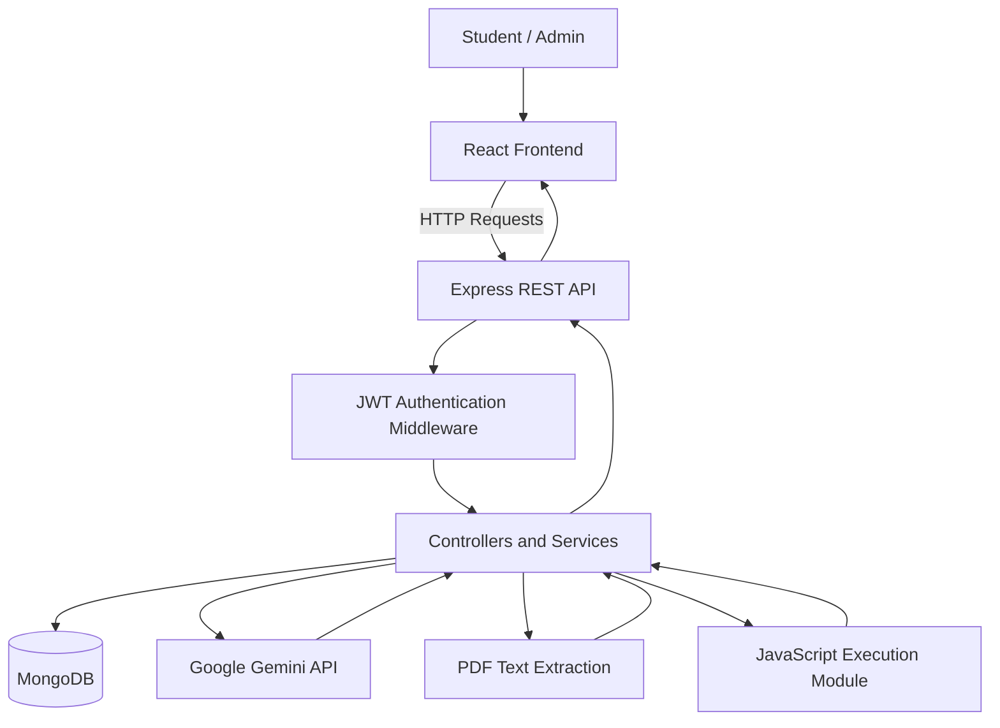

# EduAI — AI-Powered Learning & Interview Preparation Assistant

EduAI is a full-stack MERN web application that helps students prepare for technical interviews, coding assessments, behavioral rounds, and resume screening through AI-powered learning tools and personalized practice.

The platform combines an interactive React frontend with a Node.js and Express backend, MongoDB persistence, JWT-based authentication, and Google Gemini API integration.

## ✨ Key Features

- **AI Tutor:** Get programming explanations, beginner-friendly analogies, and interview preparation guidance.
- **Technical Quizzes:** Practice technical questions with explanations and assessment feedback.
- **ATS Resume Analyzer:** Upload PDF resumes, extract text, analyze skills, and identify potential improvement areas.
- **Mock Interviews:** Practice technical and behavioral interviews using voice input or text, with structured feedback.
- **Personalized Learning Roadmaps:** Track learning progress across DSA, MERN stack development, and placement preparation.
- **Coding Practice Platform:** Solve programming problems, request hints, and execute JavaScript code with timeout controls.
- **Learning Streaks & Bookmarks:** Track activity and organize saved questions, notes, and learning resources.
- **Admin Dashboard:** Manage user accounts and visualize application analytics.
- **Responsive Interface:** Navigate an interactive dashboard with dark mode, charts, and modern UI components.

## 🛠️ Technology Stack

| Layer | Technologies |
|---|---|
| Frontend | React.js, Vite, React Router |
| Styling & UI | Tailwind CSS, Custom CSS, Lucide Icons |
| Data Visualization | Recharts |
| Backend | Node.js, Express.js |
| Database | MongoDB, Mongoose |
| Authentication | JSON Web Tokens (JWT), bcryptjs |
| API Communication | REST APIs, Axios |
| AI Integration | Google Gemini API |
| Resume Processing | Multer, PDF parsing |
| Voice Interaction | Web Speech API |
| Development Tools | Git, GitHub, Postman |

## 🏗️ System Architecture

EduAI follows a client-server architecture with a React single-page application and an Express REST API.



### Frontend

- React components and React Router for application navigation.
- API integration for authentication, learning activities, and analytics.
- Interactive dashboards and data visualization using Recharts.
- Responsive layouts, dark mode, and reusable UI components.

### Backend

- Express routes and controllers for application functionality.
- JWT authentication and role-based authorization where implemented.
- Mongoose models for persistent application data.
- Resume upload and PDF text extraction workflows.
- AI-powered responses and assessment feedback through the Gemini API.

### Database

MongoDB stores application data through Mongoose schemas. Depending on the implemented models, this may include user profiles, learning activity, bookmarks, notes, quiz results, mock interview histories, and coding submissions.

## 🚀 Getting Started

### Prerequisites

- Node.js 18 or a compatible version supported by the project dependencies.
- npm.
- A local MongoDB instance or MongoDB Atlas database.
- A Google Gemini API key for AI features that require the external service.

### 1. Clone the repository

```bash
git clone https://github.com/vishwas8671/EduAI-AI-Powered-Learning-Interview-Preparation-Assistant.git
cd EduAI-AI-Powered-Learning-Interview-Preparation-Assistant
```

### 2. Install backend dependencies

```bash
cd backend
npm install
```

### 3. Configure environment variables

Create a `.env` file inside the `backend/` directory.

```env
PORT=5000
MONGO_URI=mongodb://127.0.0.1:27017/eduai
JWT_SECRET=replace_with_a_long_random_secret
GEMINI_API_KEY=your_gemini_api_key
NODE_ENV=development
```

Use your actual database connection string and API key. Never commit `.env` files, production secrets, or private credentials to GitHub.

### 4. Seed sample data (if supported)

If the repository includes a `seed.js` script that creates sample users and application data, run:

```bash
cd backend
node seed.js
```

Use only the test credentials defined by the actual seed script. Do not assume that example credentials work unless the script creates them.

### 5. Start the backend

From the `backend/` directory:

```bash
npm start
```

Confirm the server is running on the configured port.

### 6. Start the frontend

Open a second terminal:

```bash
cd frontend
npm install
npm run dev
```

Open the local URL printed by Vite in the terminal, commonly `http://localhost:5173`. Your project's configured port may differ.

## 🔐 Security Considerations

- Store credentials and API keys in environment variables.
- Hash passwords before storing them and validate authentication tokens on protected routes.
- Apply server-side authorization checks to privileged operations.
- Validate uploaded files, enforce size limits, and handle parsing errors.
- Node.js `vm` timeouts can help limit execution time, but the `vm` module alone is **not a complete security boundary for running untrusted code**. Strong isolation requires an appropriately configured sandbox, container, or separate execution service.
- Configure CORS, request validation, rate limiting, and production error handling as appropriate before public deployment.

## 📂 Repository Structure

The application is organized into separate frontend and backend directories. A representative structure is shown below; actual filenames may differ.

```text
EduAI/
├── frontend/
│   ├── src/
│   ├── public/
│   ├── package.json
│   └── vite.config.js
├── backend/
│   ├── routes/
│   ├── controllers/
│   ├── models/
│   ├── middleware/
│   ├── package.json
│   └── server.js
├── .gitignore
└── README.md
```

## 🌱 Future Improvements

- Add comprehensive automated testing for APIs and frontend workflows.
- Strengthen code execution isolation using a dedicated sandbox service.
- Improve resume analysis with structured skill matching and configurable scoring criteria.
- Add more detailed learning analytics and progress reports.
- Expand deployment monitoring, logging, and API performance optimization.

## 👨‍💻 Author

**Vishwas Rajput**

- GitHub: [vishwas8671](https://github.com/vishwas8671)
- Portfolio: [View Portfolio](https://vishwas-portfolio-xcqo.vercel.app)
- Project Live Link : https://ai-powered-learning-interview-assis.vercel.app/login

---

EduAI brings interview preparation, coding practice, resume analysis, and AI-assisted learning together in one web application.
